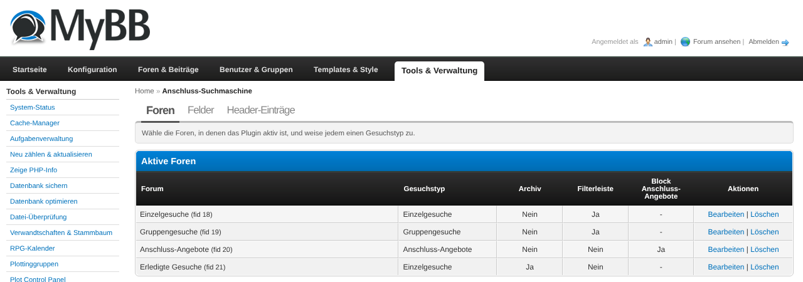
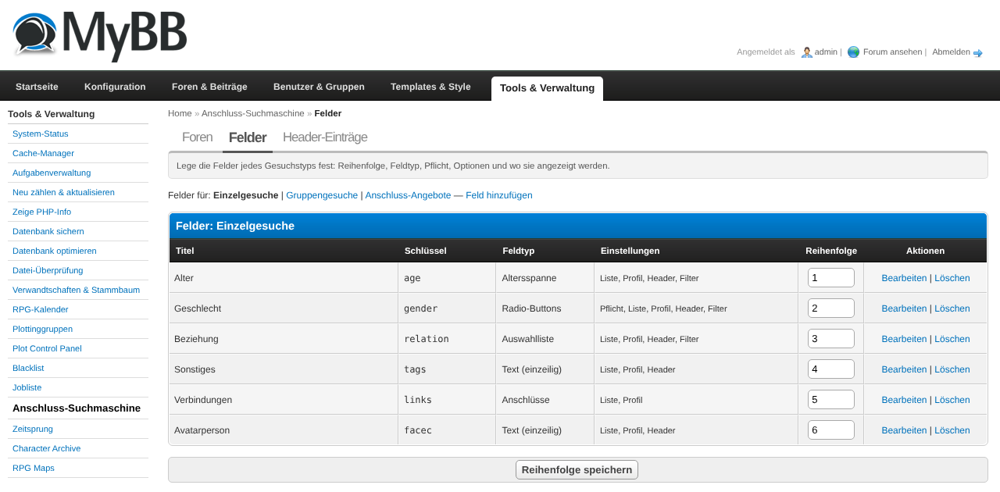
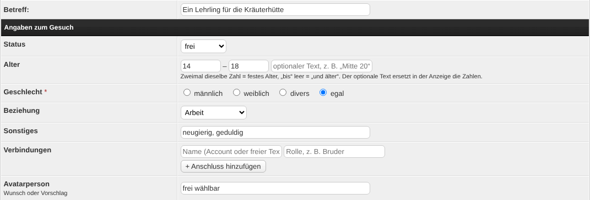
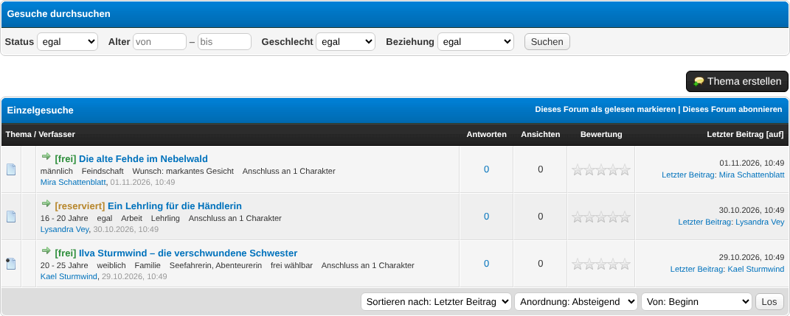
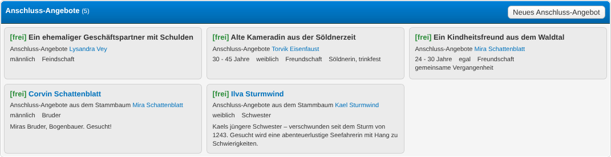
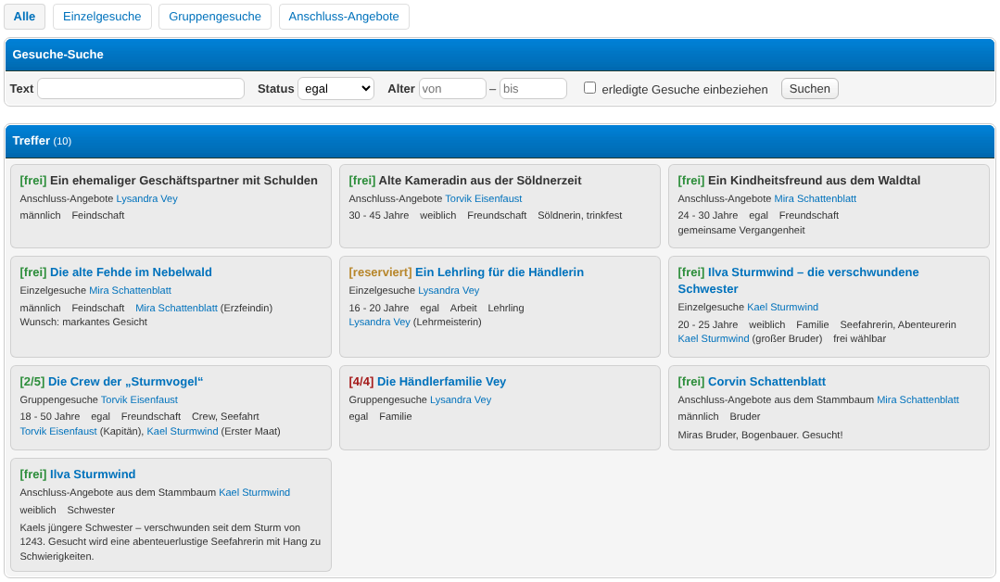

# Anschluss-Suchmaschine

A MyBB 1.8 plugin for character-based roleplay forums that manages **wanted-character ads**
(German RPG slang: *Gesuche*) in one place. Ads stay normal MyBB threads in the forums you
choose, but get structured fields (status, age range, gender, relation, connections …) that are
shown in the thread list, in the profile, in a header teaser and on a search page. Besides
single and group ads there are *loose ads* without a thread – created in the User CP or taken
from persons marked as wanted in the *Relatives* plugin.

Built for RPG forums that used xThreads fields, PHP templates and several small plugins for this
job and want a single, searchable solution.

## Requirements

- MyBB 1.8.x
- PHP 7.4 or 8.x
- MySQL 5.7+ / MariaDB 10.2+ (InnoDB)
- **No dependencies.** Optional:
  - *Relatives & Family Tree* **2.2.0 or later** – persons marked as wanted appear as loose ads.
  - Enhanced Account Switcher – the profile lists the ads of all accounts of a player.
  - Font Awesome in your theme – the default field icons use Font Awesome classes (any CSS
    class works, or none).

## Installation

1. Upload the contents of this repository into your MyBB root directory. `anschluss.php` goes next
   to `index.php`; the folders `admin/`, `inc/` and `jscripts/` merge with the existing ones. The
   folder `tests/` is only needed for development and can be left out.
2. **ACP → Configuration → Plugins** → *Anschluss-Suchmaschine* → **Install & Activate**.
   Activation creates the templates, the stylesheet `anschlusssuche.css` in every theme, a
   marker `{$anschlusssuche_fields}` in the core templates `newthread` and `editpost`, a
   *Loose ads* link in the User CP navigation and – if no fields exist yet – a generic set of
   default fields for every ad type.
3. **ACP → Configuration → Settings → Anschluss-Suchmaschine** → review the settings (see
   [Configuration](#configuration)).
4. **ACP → Tools & Maintenance → Anschluss-Suchmaschine** → assign your forums (see
   [Usage](#usage)).
5. Place the template variables where you want them:
   - `{$anschlusssuche_profile}` – the ads block in the profile. **ACP → Templates & Style →
     Templates → *your template set* → Member Templates → `member_profile`** (or the template
     your theme uses for the profile).
   - `{$anschlusssuche_header}` – the header teaser, e.g. in the `header` template.

## Usage

### First steps after activation

1. **ACP → Tools & Maintenance → Anschluss-Suchmaschine → Forums** – choose a forum, an
   **ad type** and save. Repeat for every ad forum:
   - **Single ads** / **Group ads** – threads in this forum get the fields of the type.
   - **Loose ads** – shows the loose ads as cards above the thread list; threads there stay
     normal threads (e.g. for questions or instructions).
   - **Archive** – ads in this forum count as *done*: greyed out in the thread list, hidden from
     header and search by default. Moving a thread into an archive forum is enough.
   - **Filter bar** – shows a small search form above the thread list.
2. **… → Fields** – adjust the fields of each ad type (see below).
3. Place `{$anschlusssuche_profile}` and `{$anschlusssuche_header}` (Installation step 5).

### Managing fields (Admin)

**ACP → Tools & Maintenance → Anschluss-Suchmaschine → Fields** → choose the ad type → *Add field*
or *Edit*:

- **Title**, **Key** (lowercase, unique per type, used in search links) and **Description**
  (help text in the form).
- **Field type**:
  - *Text*, *Text (multiple lines)*, *Number*.
  - *Select box*, *Radio buttons*, *Checkboxes* – options one per line. Renaming an option in the
    same line also renames the stored values.
  - *Age range* – from/to plus an optional display text (e.g. "mid 20s"); max. one per type.
    The search finds ads whose range overlaps the searched range.
  - *Connections* – a list of name + role; names can be linked to accounts (username
    suggestions while typing) and then link to the profile.
- **Icon** – a CSS class such as `fas fa-users`.
- **Required**, **Order**, **Show in thread list / profile / header**, **Filterable**,
  **Active** (inactive fields are hidden, their data is kept).

The order can also be changed directly in the list (*Save order*). Deleting a field deletes its
stored values – set it inactive if you want to keep them.

### Writing an ad (Members)

Create a new thread in an ad forum as usual. Below the subject you find the block **Ad details**:

- **Status** – free, reserved or taken. For **group ads** you also enter the **slots**
  (found / wanted in total, optionally *open-ended*). Unless *set status manually* is ticked,
  a group ad becomes *taken* automatically once all slots are filled.
- The fields defined in the ACP; required fields are marked with `*`.

Editing the first post of the thread changes the ad. Drafts can be saved with incomplete fields.

### Thread list

In ad forums every thread shows a status badge (`[free]`, `[reserved]`, `[taken]`, `[done]`,
group ads `[1/3]`) and a line with the fields marked *Show in thread list*, plus the number of
connected characters. The look comes from the template `anschlusssuche_forumdisplay_thread`
(global) – copy it into your template set to adapt it to your theme.

### Loose ads (Members)

**User CP → Loose ads** (link in the *Miscellaneous* box) → *New loose ad*: title, status, age
and the fields of the type *loose*. Loose ads appear in the loose-ads forum, in the search and
in the profile. Who may create them and how many per account is set in the settings.

With *Relatives* 2.2.0+ installed, every person marked as wanted there is shown as a loose ad as
well (name, age, gender, relation, description, link). Those are edited in *Relatives*, not here.

So that the loose-ads forum does not look empty, the forum list (index and sub-forum lists)
counts all loose ads in its *Threads* and *Posts* columns and shows the newest loose ad as
*Last post* whenever it is newer than the last real post; the link leads into the forum.

### Profile

`{$anschlusssuche_profile}` lists the single, group and loose ads of the profile owner – with the
Enhanced Account Switcher of **all accounts of the same player**, also when viewing a secondary
account. Finished ads can be shown as an extra section (setting). Persons from *Relatives* are
listed under loose ads unless *Hide Relatives persons in profile* is set – useful when the
*Relatives* wanted box already appears in the same profile.

### Header teaser

`{$anschlusssuche_header}` shows a configurable number of ads: first the **fixed entries** that are
active right now, then random ads from the *Header: source forums*.

Fixed entries: **ACP → Tools & Maintenance → Anschluss-Suchmaschine → Header entries** → enter the
**thread ID** of an ad (or the ID of a loose ad), the **first** and **last day** and an optional
note. Past entries stay in the list as history.

### Search page

`anschluss.php` searches all ads: tabs *All / Single / Group / Loose*, text, status, age range and
– per tab – all filterable fields. Finished ads can be included with a checkbox. Results respect
the forum permissions of the visitor; guests may search if the setting allows it. The filter bar
in the forums opens this page with the chosen filters.

### Tips & Tricks

- The thread list cannot be filtered in place (MyBB offers no hook before the thread count), so
  the filter bar always leads to the search page.
- Field filters only apply to the plugin's own ads; persons from *Relatives* drop out of the
  results as soon as such a filter is set.
- Changing the type of a forum later does not change existing ads – they keep their type.
- Default status colours are CSS variables (`--anschlusssuche-free` …) in `anschlusssuche.css`.

## For developers

- `anschlusssuche_entry_save(array $entry, array $values = [], array $links = []): int` – create
  or update an ad (by `id` or `tid`); values are normalised, not HTML-escaped. Usable without a
  session (e.g. in migrations).
- `anschlusssuche_header_add(array $data): int` – add a fixed header entry (`entry_id` or
  `relatives_person_id`, `source` = `acp`/`shop`, `owner_uid`, `start_at`, `end_at`, `note`,
  `credit_id`, `created_by`).
- `anschlusssuche_get_entries_for_uids(array $uids, array $opts = []): array`.
- Hooks: `anschlusssuche_entry_saved` (`['entry_id', 'is_new']`), `anschlusssuche_header_collect`
  (`['items' => &$items]`), `anschlusssuche_search_start` / `_end`.

## Configuration

**ACP → Configuration → Settings → Anschluss-Suchmaschine**

- **Enable plugin** – master switch for all front-end features.
- **Search for guests** – guests may use `anschluss.php`.
- **Search results per page** – page size of the search page.
- **Loose ads per page** – cards per page in the loose-ads block.
- **Groups allowed to create loose ads** – user groups for the User CP page.
- **Max. loose ads per account** – 0 = unlimited.
- **Include Relatives** – show persons marked as wanted in *Relatives* (2.2.0+).
- **Relatives gender mapping** – `code=label` per line; maps the Relatives gender codes
  (0 male, 1 female, 2 diverse by default) to the labels shown and searched.
- **Show in profile** – fill `{$anschlusssuche_profile}`.
- **Show finished ads in profile** – extra section for ads in archive forums.
- **Hide Relatives persons in profile** – leave persons from *Relatives* out of the profile
  block, e.g. when the *Relatives* wanted box is already shown in the profile (default: off).
- **Header teaser** – fill `{$anschlusssuche_header}`.
- **Header: number of ads** – fixed + random.
- **Header: source forums** – forums for random ads; forums without an ad type show the subject
  only.
- **Header: include loose ads** – add own loose ads to the random pool.
- **Header: only open ads** – random ads only with status *free*.
- **NewPoints shop (prepared)** / **Shop: max. concurrent header slots** – reserved for a later
  version, currently without effect.

## Uninstallation

**ACP → Configuration → Plugins** → *Anschluss-Suchmaschine* → **Deactivate** (removes templates,
stylesheet, the form markers and the User CP link; data and settings stay), then **Uninstall**
(removes all tables, settings and the ACP permission). Remove `{$anschlusssuche_profile}` and
`{$anschlusssuche_header}` from your templates and delete the plugin files.

## Changelog

See [CHANGELOG.md](CHANGELOG.md).
